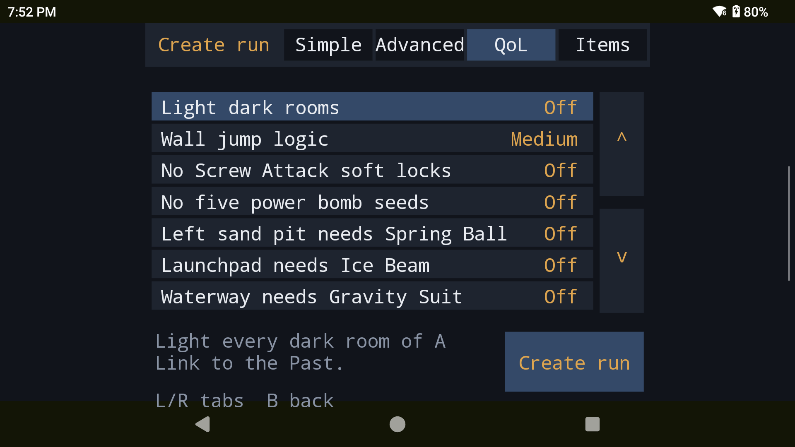
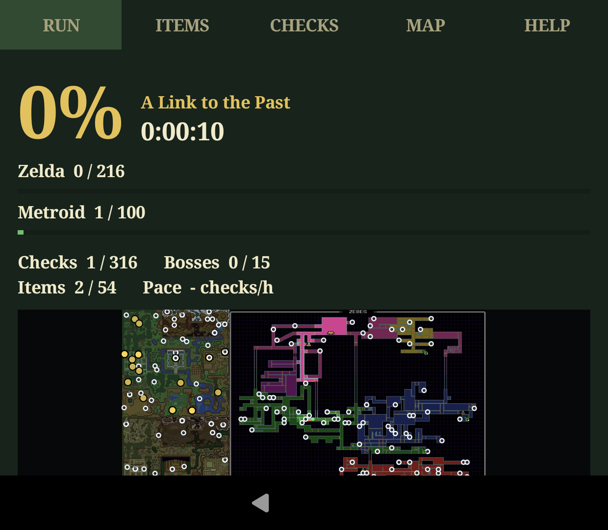

# SMZ3-thor-3ds

Dual-screen SMZ3 (Super Metroid + A Link to the Past combo randomizer) for the Nintendo 3DS / New 3DS and the AYN Thor.
The top screen runs the game; the bottom screen shows the run: current map, items and checks, run data, and what is reachable by logic.

Status: playable on the AYN Thor, the 3DS (Azahar-tested) and PC (Linux; Windows cross-built and run under Wine; macOS compiled in CI (Intel runner), never run). See
[docs/PLAN.md](docs/PLAN.md).

## Android app (AYN Thor)

The Android app is **SMZ3** (`com.utsugi.smz3`; the debug build is `com.utsugi.smz3.debug`, "SMZ3 debug"). It is a fork of
[Lemuroid](https://github.com/Swordfish90/Lemuroid) (GPL-3.0) on top of LibretroDroid, with the run menu, the generator and
the bottom-screen tracker added in `vendor/` through `patches/*.patch`. Lemuroid's code keeps its own package names inside the app.

```bash
./build-android.sh            # build/smz3-debug.apk
./build-android.sh release    # build/smz3-release.apk, signed with a local key (vendor/Lemuroid/release.jks, not in git)
```

The app has its own data: runs made in the old `com.swordfish.lemuroid.debug` build are not carried over (saves under
`/sdcard/SMZ3/saves` are shared). After installing, allow notifications once (the game will not start without it).

**Item shortcuts.** The RUN tab has a row over the map. In A Link to the Past it has five slots, the same for every run:
tap an empty one to pick one of the items you own, then tap it to put that item on Y. In Super Metroid it shows the beams you
have (Wave, Ice, Spazer, Plasma) and a tap turns one on or off; Spazer and Plasma never stay on together. Hold a slot or a
beam to change it or to bind a pad button to it; a button the SNES mapping, a hotkey or an emulator shortcut already uses is
refused with what uses it. Shortcuts act only in normal play. The CONFIG tab hides the row.

### Run editor

| Options (QoL tab) | Run screen |
|---|---|
|  |  |

## Getting started on each device

Nothing derived from a ROM is shipped. You need your own **Super Metroid (JU)** and **A Link to the Past (Japan v1.0)** dumps (other revisions are
refused with the reason). Loose files, zips or a folder all work, with or without a copier header.

| Device | How the two ROMs get in |
|---|---|
| **PC** (Linux, Windows, macOS) | Drop both files (or a zip) on the window, or `smz3 setup <rom|zip|folder>...`. A copy is kept in the data folder (`%APPDATA%\smz3`, `~/.local/share/smz3`, `~/Library/Application Support/smz3`; `portable.txt` beside the program keeps it next to it). |
| **Thor / Android** | Create a run: with no ROMs known, the system file picker opens (select both files or a zip once). |
| **3DS** | Copy both ROMs (or a zip) to `/SMZ3/base` on the SD card (`roms`, `roms/snes` and the card root are searched too). |

### PC controls

The PC app works completely with a game controller. In the run list, **Select** (or F1) opens the settings: reassign the buttons, video (full screen, window size, aspect ratio, filter, minimap side and size) and quit. If the ROMs go missing, the app asks for them again when it opens. While playing, the right stick click toggles the tracker and the left stick click leaves the run (both can be reassigned too). The tracker's Help tab lists every control with the buttons of the device in use.

- **Map tab:** the triggers or the right stick zoom, **A** (or F) follows the player, **Y** (or D) switches to the dungeon pictures, where the D-pad picks the dungeon and floor (each one shows the checks still to get) and **A** returns to Link's floor.
- **Video while playing:** V, or X in the tracker, opens the video options over the game so each change shows at once.
- **Save states** (runs made with Save states on, never ladder runs): F5 save, F7 load, F6/F8 slot; on a pad, Select + R1 / L1 / Left / Right.
- **Item shortcuts:** Settings > Item shortcuts binds a key and a controller button to each ALttP item (puts it on Y) and to each Super Metroid beam (turns it on or off). Keys and buttons the game screen uses are refused. A shortcut does nothing for an item you don't have, or outside normal play.
- **Fast forward** (Space or the right trigger) keeps the music playing at its pitch.
- **Reachable checks** on the map are a run option (Play tab), off by default and on in the Cozy run.
- The run ends when control is lost: Link entering the Triforce room, or Samus entering her ship, once both final bosses are beaten. A card shows the final time with hundredths; ladder times keep the hundredths too.

### Installing the PC app

Grab the files from the latest release: Linux `SMZ3-x86_64.AppImage` (make it executable and run it), Windows `SMZ3-windows-x64.zip`, macOS `SMZ3-macos-intel.tar.gz`. `tools/build-appimage.sh` rebuilds the AppImage after `./build-pc.sh`.

### macOS: opening the unsigned app

The macOS build is not signed or notarized, so Gatekeeper refuses it the first time ("cannot be opened because the developer cannot be verified"). Either:

```bash
tar xzf smz3-macos.tar.gz
xattr -d com.apple.quarantine smz3     # clears the download flag; then ./smz3 opens normally
chmod +x smz3
```

or try to open it once, then go to System Settings -> Privacy & Security and press "Open Anyway" next to the blocked-app message. Running `./smz3` from Terminal after clearing the flag is the simplest route. It needs SDL2 (`brew install sdl2`) because the macOS binary links it dynamically. Windows may show a SmartScreen warning for the same reason: "More info" -> "Run anyway".

Builds: `./build-pc.sh` (native), `./build-pc.sh windows` (MinGW cross-build), `.github/workflows/pc.yml` (Linux, Windows and macOS artifacts),
`./build-android.sh`, `./build-3ds.sh`.

## Building it yourself

No binaries, ROMs or generated games are distributed here: only source, patches and build scripts. You build the app and the
3DS homebrew yourself and supply your own legally obtained ROMs.

- **Thor / Android:** `./build-android.sh` (see above). JDK 21, Android SDK and NDK required.
- **3DS:** `./build-3ds.sh` produces `snes9x_smz3.3dsx` (devkitPro + devkitARM required); run it on a 3DS with the Homebrew
  Launcher or in the Azahar emulator.
- **ROMs:** place your own A Link to the Past and Super Metroid dumps as described below; the app generates the SMZ3 game on
  the device.

## ROMs

`rom/` is gitignored. Local copies used for development:

| File | Source | SHA-1 |
|---|---|---|
| `alttp_usa.sfc` | A Link to the Past (USA) | `6d4f10a8b10e10dbe624cb23cf03b88bb8252973` |
| `supermetroid_ju.sfc` | Super Metroid (Japan, USA) (En,Ja) | `da957f0d63d14cb441d215462904c4fa8519c613` |
| `smz3_test_popoie_fang.sfc` | already generated SMZ3, for tracking tests | `c74bd08d523cc8ad995cda975039d840849cc85a` |
